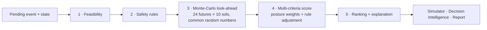

# Decision engine

`src/core/decision` evaluates every option of a pending mission event and recommends one. It is **deterministic**: the same simulator state, event and risk posture always produce the same scores, recommendation and explanation. It uses no LLM. The physics comes from the same simulator that runs the mission.

## 1. Feasibility

`optionFeasibility(state, option)` checks an option's requirements: minimum subsystem health, spare kits, an Earth link, and whether EVA is allowed now (no shelter order, no SEP, τ < 4, crew health > 40 %). An infeasible option is vetoed (`R-FEASIBLE`), shown with its reasons, and cannot be chosen.

## 2. Safety rules (`rules.ts`)

| Rule | Effect | Trigger (summary) |
| --- | --- | --- |
| R-FEASIBLE | veto | Requirements not met |
| R-SEP-EVA | veto | Outdoor work during a solar particle event (NASA-STD-3001 SPE limit 250 mSv) |
| R-DUST-EVA | −0.08 | EVA with projected dust optical depth ≥ 3 |
| R-POWER-CRITICAL | +0.06 / −0.06 | Battery below 0.6 sol of base load: rewards load shedding, penalises added demand |
| R-O2-LOW | +0.06 / −0.04 | O₂ stock covers few sols: rewards restoring O₂, penalises spending it |
| R-HEALTH-LOW | −0.06 / +0.04 | Low crew health: penalises strenuous EVAs, rewards medical care and shelter |
| R-SPARES-LOW | −0.03 | Using the last spare kits |
| R-SHELTER-CAPACITY | +0.05 | Low habitat integrity: rewards repair or relocation |
| R-ISRU-WEAR | −0.05 | Boosting a worn ISRU plant |
| R-PROTOCOL | +0.03…+0.04 | The option follows a survival protocol (P-01 SEP shelter, P-03 O₂ loop first, P-05 dust storm shelter or load shedding) |
| R-HEATING | note | Load shedding while the habitat is cold |

Vetoes exclude an option. Penalties and bonuses are summed into a **rule adjustment** that is added to the score, and each one carries a human-readable message.

## 3. Monte-Carlo look-ahead

For each feasible option and each of `samples` = 24 futures:

1. Copy the state with seed variant *k* (`withSeedVariant`). All options use the **same 24 variants** (common random numbers), so differences between options are not noise.
2. Apply the option (`chooseOption`), including its risk draw (complication).
3. Advance `horizon` = 10 sols with `stepSol`. Future events are resolved with their default option (`defaultPolicy`).
4. Record survival, the lowest reserve along the way (min of O₂, water and food reserve sols), the end health, morale and battery, resources spent, science gained, and whether a **critical state** occurred (failure, reserve < 5 sols, or health < 40 %).

Per option:

| Metric | Definition |
| --- | --- |
| survivalProbability | Share of futures without mission failure |
| minReserveSols | Median of the per-future lowest reserve |
| expectedHealth, expectedMorale | Mean end values |
| resourceCost | Mean consumables and spare kits spent, in crew-sols of supply |
| scienceDelta | Science points gained over the horizon |
| complicationProbability | Probability of the option's own risk |
| riskIndex | `clamp01(criticalShare + 0.5·complicationProbability)`; 1 if vetoed |
| trajectory | Per-sol median O₂ and water reserve, battery and health (plotted) |

## 4. Multi-criteria score

Each criterion is normalised to 0–1:

| Criterion | Normalisation |
| --- | --- |
| survival | survivalProbability |
| reserves | min(1, minReserveSols / 30) |
| health, morale | value / 100 |
| cost | 1 − (cost − min)/(max − min) across options (1 when the spread < 0.05) |
| science | (science − min)/(max − min) across options (0.5 when the spread < 0.25) |
| risk | 1 − riskIndex |

`score = Σ weight_c · normalised_c + rule adjustment`, with weights set by the mission's **risk posture** (each row sums to 1):

| Posture | survival | reserves | health | morale | cost | science | risk |
| --- | --- | --- | --- | --- | --- | --- | --- |
| conservative | 0.34 | 0.20 | 0.16 | 0.05 | 0.10 | 0.05 | 0.10 |
| balanced | 0.28 | 0.16 | 0.14 | 0.07 | 0.12 | 0.13 | 0.10 |
| aggressive | 0.22 | 0.12 | 0.12 | 0.08 | 0.12 | 0.24 | 0.10 |

## 5. Recommendation and explanation

- **Ranking**: feasible options only, by score, then survival probability, then option id. The top one is recommended.
- **Rationale** (`buildRationale`): states the recommendation and its score, the criterion where it beats the runner-up most, any trade-off accepted (where the runner-up is better), and the rules that fired.
- **Consequences** (`describeConsequences`): survival over the horizon, the median end state, the lowest reserve on the way, spares used, the complication risk, ongoing effects and science.
- **Risks** and **critical resources** describe the current state before the decision.
- **Determinism key**: `hash(seed, sol, event id, horizon, samples, posture, option ids)`, displayed so any analysis can be reproduced.
- When the crew chooses, the decision record stores the engine's recommendation and whether it was followed. Reports summarise this.

Typical runtime: 15–30 ms per analysis in the browser (4 options × 24 futures × 10 sols).

## Optional LLM narration

`/api/mars-advisor` with `{ mode: "narrate", analysis }` returns a plain-language briefing. The server first compacts the analysis (`summarizeAnalysis`: labels, scores, survival, reserves, complications, consequences, rationale, key). The prompt instructs the model to use only those numbers, keep the recommendation, and say that the values are simulation outputs. Without `GEMINI_API_KEY` (or on error) a deterministic narrative is built from the rationale instead. The narration never changes the mission state or the decision, and the UI labels which mode produced it.

## Tests

`src/core/decision/decision.test.ts` (every alternative evaluated, highest feasible score recommended and explained, the dust-storm EVA penalty, determinism, posture weights summing to 1, the SEP and requirement vetoes, preferring O₂ protection when the reserve is critical, risk identification), `src/state/missionStore.test.ts` (recording whether the recommendation was followed) and `src/services/advisor.test.ts` (narration contract).
