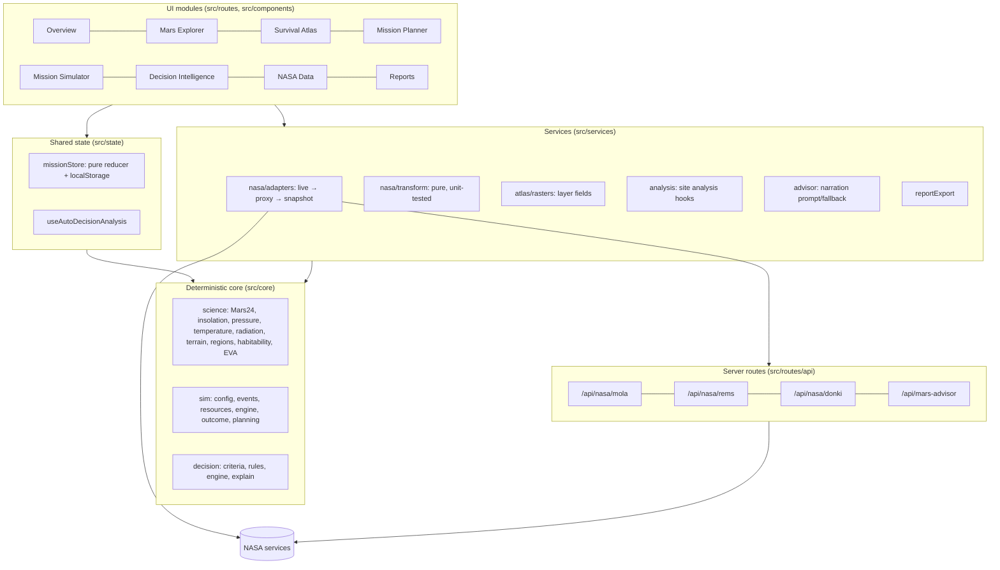

# System architecture

MARS // SURVIVE is a single TanStack Start application. A **deterministic core** of pure TypeScript functions (science models, simulator, decision engine) sits under a **services** layer (NASA adapters, atlas rasters, analysis), one **shared mission state**, and the **UI modules**. No module keeps private mission data: each reads and writes the shared state.



## Directory layout

```
src/
  core/                  pure, framework-free, unit-tested
    types.ts             shared domain types (plans, environment, sim state, analyses, reports)
    rng.ts               mulberry32 + hashed sub-streams (common random numbers)
    science/             constants, geo, marsTime, insolation, environment, terrain, regions, habitability, eva, evaWalk, routing (A*), roverTraverse
    sim/                 config (scenarios, rates, thresholds), events, resources, engine, outcome, planning, fixtures
    decision/            criteria + posture weights, rules, engine (analyzeDecision), explain
  data/                  static registries: sites, layers (10), sources, evaSites (Access Mars), boxwork (Curiosity 2025 waypoints + stops)
  services/
    nasa/                http helpers, transform (pure), adapters (client), hooks (React Query)
    atlas/rasters.ts     layer fields from MOLA + models, colourisation, readouts
    analysis.ts          analyzeSite / useGrid / useSiteAnalysis
    advisor.ts           LLM narration summary, prompt and deterministic fallback
    reportExport.ts      Markdown / CSV builders
  state/
    missionStore.ts      reducer, persistence, useMission()
    useDecisionAnalysis.ts
  components/
    shell/AppShell.tsx   sidebar, Mars clock, data links, flow stepper, footer
    mission/             UI kit (badges, panels, metrics), effect/protocol helpers
    atlas/               Leaflet map + raster image cache
    explorer/            Globe (R3F), SurfaceEva (Access Mars terrain + HUD), BoxworkTraverse (Leaflet + HiRISE)
    …legacy components   MarsExplorer, NasaDataAtlas, SurvivalSimulator, … (kept)
  routes/                file routes; api/ holds server routes
scripts/fetch-nasa-data.ts   offline snapshot downloader (npm run data:fetch)
public/eva/              Access Mars subset (Apache-2.0) · public/draco/ decoder · public/data/nasa/ snapshots
```

## Shared mission state

`src/state/missionStore.ts` holds one immutable `MissionStoreState`:

| Field | Written by | Read by |
| --- | --- | --- |
| `selectedSite`, `analysis` | Explorer, Atlas, Planner (`selectSite`) | every module |
| `comparison` (≤ 3) | Atlas, Explorer (`pinComparison`) | Atlas comparison table |
| `traverse` (≤ 12 waypoints) | Explorer, Atlas (`addTraversePoint`, …) | Globe, Atlas routes layer |
| `evaPlan` | Explorer surface mode (`setEvaPlan`) | Planner → simulator EVAs |
| `plan` | Planner (`savePlan`) | Simulator, Decisions sandbox |
| `sim`, `activeRunId` | Simulator / Decisions (`startSimulation`, `advance`, `choose`) | Simulator, Decisions, shell, Overview |
| `lastAnalysis` | `useAutoDecisionAnalysis` (`setDecisionAnalysis`) | Simulator, Decisions, `choose` (records whether the crew followed the engine) |
| `reports` (≤ 12) | filed automatically when a run reaches an outcome | Reports, Overview |

The reducer is pure and covered by tests. The store wraps it with `useSyncExternalStore`, persists to `localStorage` (`mars-survive:mission:v1`), validates persisted data defensively, and syncs between tabs through the `storage` event.

## End-to-end flow (11 steps)

1. **Select**: click the globe or the atlas, or pick a catalogue site → `selectSite(analyzeSite(site, MOLA))`.
2. **Analyse**: atlas layers and readouts, site analysis (scores and flags), comparison.
3. **Route**: optional regional traverse (great circles) and EVA route on real terrain → `evaPlan`.
4. **Plan**: planner validates with zod, sizes supplies, previews feasibility → `savePlan`.
5. **Launch**: `startSimulation` → `createInitialState(plan)` (seeded).
6. **Advance**: `advance` → `runUntilDecision` (sol by sol until an event or the end).
7. **Event**: the simulator raises a `MissionEvent` with options; the state becomes `awaiting-decision`.
8. **Consult**: `analyzeDecision` (rules + Monte-Carlo + MCDA) runs automatically and its result is stored.
9. **Decide**: `choose(optionId)` → `chooseOption` applies effects, risk draws and ongoing effects, and records the decision.
10. **Consequences**: history charts, log, protocol monitor and trajectories show the effect.
11. **Evaluate and report**: success / compromised / failure → `buildReport` → Reports (exports).

## Rendering and SSR

The root shell is server-rendered. Module routes use `ssr: false` because they rely on WebGL, Leaflet (which touches `window`), canvas and `localStorage`. Leaflet is imported dynamically. drei `<Html>` is avoided inside the WebGL trees, because its extra React roots raced React 19 unmounts (`removeChild` errors). Labels are canvas-texture sprites and loading states are DOM overlays.

## Testing strategy

- **Unit (Vitest)**: science models (Mars time including year numbering, insolation, pressure, temperature and its REMS calibration, terrain sampling, EVA, EVA walk timeline, A* safe routing), simulator (consumption, sol advance, events, outcomes, purity and reproducibility, event injection), decision engine (rules, determinism, posture weights, feasibility), planning (sizing, feasibility preview), store (lifecycle, persistence), transforms (MEGDR, REMS, traverses, DONKI), adapters (fallback order, Trek URLs), effect and protocol helpers, advisor narration, report exports.
- **Type safety**: `tsc --noEmit` with `strict` and `exactOptionalPropertyTypes`.
- **End-to-end check**: headless Chrome (Playwright) drove the whole flow: atlas → planner → simulator → decisions → reports, plus the globe and the Access Mars terrain with waypoint picking.
